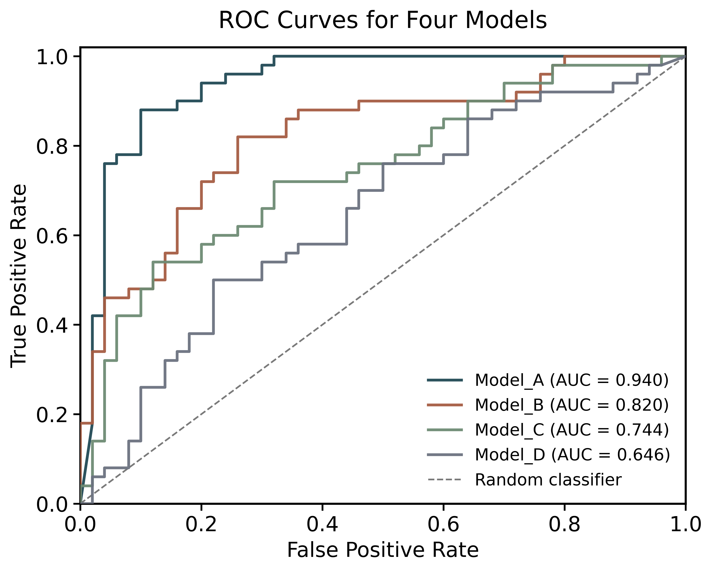

# BSEN10040 Reusable AUC–ROC Plotting Template

A classroom-ready Python and Jupyter example for creating publication-style ROC curves and comparing the area under the curve (AUC) for multiple binary-classification models.



## Repository contents

The `AUC-ROC/` folder contains:

- `auc_roc.ipynb` — an executable teaching notebook with the generated plot embedded in its output.
- `auc_roc.py` — the reusable command-line plotting script.
- `auc_demo_data.csv` — example predictions from four models.
- `auc_demo_data_3_models.csv` and `auc_demo_data_7_models.csv` — additional example datasets.
- `auc_demo_data_roc.png` — the figure generated by running the notebook.
- `auc_demo_data_roc_summary.csv` — AUC values and threshold counts generated alongside the figure.

## Setup

Clone the repository, create a virtual environment, and install the dependencies:

```bash
git clone https://github.com/dzjxzyd/BSEN10040-reusable-plotting-template.git
cd BSEN10040-reusable-plotting-template

python -m venv .venv
source .venv/bin/activate        # macOS/Linux
# .venv\Scripts\activate       # Windows

python -m pip install -r requirements.txt
```

## Run the notebook

Start Jupyter from the repository root:

```bash
jupyter lab
```

Open `AUC-ROC/auc_roc.ipynb` and run all cells from top to bottom. The notebook reads `auc_demo_data.csv` and regenerates both the PNG figure and summary CSV.

## Run the Python script

```bash
cd AUC-ROC
python auc_roc.py auc_demo_data.csv
```

Specify a custom output filename or title when needed:

```bash
python auc_roc.py auc_demo_data_7_models.csv \
  --output seven_models_roc.png \
  --title "ROC Comparison for Seven Models"
```

## Input format

Use a wide-format CSV file with:

- one `true_label` column containing binary labels;
- an optional `sample_id` column; and
- one probability column per model.

```csv
sample_id,true_label,Model_A,Model_B
S001,0,0.12,0.31
S002,1,0.88,0.67
```

Each model column is plotted as a separate ROC curve and included in the generated summary table.
